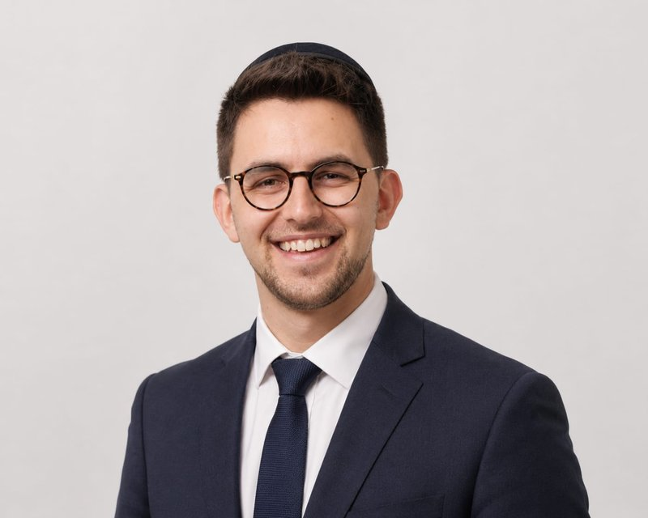

## Musical Director

Surrounded by music his whole life, Harry’s passion for vocal music came
from the great initial influence of a cappella group Jonah and the Wailers
under the direction of his father, Simon Style. Harmonising with his family
in the car on holidays, singing in vocal groups quickly became a regular and
constant activity, so much so that he was singing in Woodside Park Shul
Choir from the age of 10. Under the leadership of chazzan Stephen Robins and
conductor Simon Appleman for the High Holidays, he was introduced to the
Stephen Glass lexicon and the world of Jewish Choral music.

In addition to Harry’s main focus of composing, arranging and musically
directing in the musical theatre industry, his roots have secured his place
in the London Jewish music scene, singing with a cappella function group The
Ahmen Singers and also leading the Central Synagogue Choir. Harry joined the
Shabbaton Choir as musical director in 2022 and has enjoyed leading the
choir in a plethora of services, concerts and events in and around London.

## Conductor Laureate

Stephen Levey’s association with the Choir began as a chorister in 1986. In
1991 Stephen was invited to conduct the Choir for the Induction Service of
Chief Rabbi Lord Sacks and he remained the Choir’s devoted Conductor and
Musical Director until 2020. Stephen’s melodic compositions for the choir
have become established favourites in services and concerts. Under his
leadership, the Choir has built up a reputation for a mellow sound,
sensitive singing and a rich interpretation of our tefillot. One of
Stephen’s compositions, Oseh Shalom, was recorded in a West London studio,
sung by the Choir with Jonny, Shimon, Lionel and children of the Moriah
Jewish Day School (and the Chief Rabbi), and was released on YouTube. It has
become a worldwide hit, having reached over 3.2 MILLION hits!

Stephen more recently worked with Raymond Goldstein (Jerusalem Great
Synagogue). At the Barbican Hall, London in May 2013, Stephen premiered Anim
Z’mirot written in honour of Emeritus Chief Rabbi Lord Sacks, and sung by
the Choir with Chazanim Rabbi Lionel Rosenfeld, Shimon Craimer and Jonny
Turgel, and 300 school children. In June 2020, the Shabbaton Choir announced
the appointment of Stephen as their first-ever Conductor Laureate. As
Conductor Laureate, Stephen will continue to identify opportunities for the
Choir to perform – concerts, Shabbatonim and other services – as well as
promoting the Choir to the Jewish community and more widely, within the UK,
Israel and further afield. Stephen is Director of Music at Immanuel College
in Bushey, Hertfordshire. You can read more about Stephen's music on
his website
[https://www.stephenleveymusic.com](https://www.stephenleveymusic.com)
